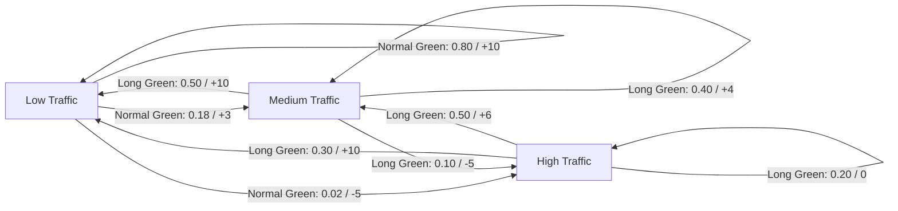

# Representation of a Real-World Problem as a Markov Decision Process

## Aim

To identify a real-world sequential decision-making problem and represent it as a Markov Decision Process (MDP) by defining its states, actions, transition probabilities, rewards, and discount factor using Python dictionaries.

## Problem Statement

### Problem Description

**Application: Adaptive Traffic Signal Control**

In a busy road junction, traffic density changes over time. A fixed-time traffic signal may give green time to a road with few vehicles while vehicles are waiting in another direction. This can increase waiting time, congestion, fuel consumption, and pollution.

An intelligent traffic-signal agent observes the traffic condition and chooses an action, such as giving more green time to the north-south road, giving more green time to the east-west road, or keeping the current timing. The objective is to reduce congestion and waiting time while maintaining safe signal operation.

This problem can be represented as an MDP because the agent repeatedly observes a state, takes an action, receives a reward, and moves to a new state.

## MDP Components

A Markov Decision Process is represented as:

\[
MDP = (S, A, P, R, \gamma)
\]

| Symbol | Meaning |
|---|---|
| \(S\) | Set of traffic states |
| \(A\) | Set of signal-control actions |
| \(P\) | Probability of transitioning to a next state |
| \(R\) | Reward received for a transition |
| \(\gamma\) | Discount factor for future rewards |

For this example, the discount factor is \(\gamma = 0.9\).

## State Space

The state describes the traffic density on the two roads approaching the junction.

- `Low`: low traffic density
- `Medium`: medium traffic density
- `High`: high traffic density

For simplicity, the state is represented by the combined traffic condition:

```python
S = [
    "Low_Traffic",
    "Medium_Traffic",
    "High_Traffic"
]
```

## Sample State

```python
sample_state = "High_Traffic"
```

This means that the junction is experiencing high traffic density and the agent should select a suitable signal-timing action to reduce congestion.

## Action Space

The agent can choose one of three actions:

```python
A = [
    "Short_Green",
    "Normal_Green",
    "Long_Green"
]
```

- `Short_Green`: provide a short green-light duration.
- `Normal_Green`: provide a normal green-light duration.
- `Long_Green`: provide a longer green-light duration.

In a real deployment, these actions must be applied to a specific road direction and constrained by minimum/maximum green times, pedestrian phases, and safety interlocks. This small model uses abstract timing actions for educational purposes.

## Sample Action

```python
sample_action = "Long_Green"
```

When traffic is high, the agent may choose a longer green phase to allow more vehicles to pass through the junction.

## Transition Probability

The transition probability \(P(s' \mid s,a)\) gives the probability of reaching the next traffic state \(s'\) from the current state \(s\) after taking action \(a\).

The following probabilities are illustrative assumptions for a simple classroom model, not measured traffic data. Each row of probabilities sums to 1.

| Current state | Action | Low next state | Medium next state | High next state |
|---|---|---:|---:|---:|
| Low_Traffic | Short_Green | 0.70 | 0.25 | 0.05 |
| Low_Traffic | Normal_Green | 0.80 | 0.18 | 0.02 |
| Low_Traffic | Long_Green | 0.85 | 0.14 | 0.01 |
| Medium_Traffic | Short_Green | 0.20 | 0.60 | 0.20 |
| Medium_Traffic | Normal_Green | 0.35 | 0.55 | 0.10 |
| Medium_Traffic | Long_Green | 0.50 | 0.40 | 0.10 |
| High_Traffic | Short_Green | 0.05 | 0.25 | 0.70 |
| High_Traffic | Normal_Green | 0.15 | 0.45 | 0.40 |
| High_Traffic | Long_Green | 0.30 | 0.50 | 0.20 |

These probabilities model the idea that longer green time can make a reduction in traffic more likely. Actual probabilities should be estimated from sensor observations or traffic simulations.

## Reward Function

The reward encourages the agent to reduce congestion. Positive rewards are given when traffic becomes lighter, while negative rewards are given when traffic remains heavy.

| Current state | Action | Low next state | Medium next state | High next state |
|---|---|---:|---:|---:|
| Low_Traffic | Short_Green | 10 | 3 | -5 |
| Low_Traffic | Normal_Green | 10 | 3 | -5 |
| Low_Traffic | Long_Green | 8 | 2 | -8 |
| Medium_Traffic | Short_Green | 10 | 3 | -5 |
| Medium_Traffic | Normal_Green | 10 | 5 | -5 |
| Medium_Traffic | Long_Green | 10 | 4 | -5 |
| High_Traffic | Short_Green | 10 | 3 | -5 |
| High_Traffic | Normal_Green | 10 | 5 | -3 |
| High_Traffic | Long_Green | 10 | 6 | 0 |

The reward values are illustrative. A real system could calculate rewards using measured queue length, vehicle delay, throughput, and pedestrian waiting time.

## Graphical Representation

The following graph illustrates possible state transitions. Arrows are labeled with an example action and transition probability; rewards are shown after the slash.



## Python Representation

```python
# MDP Representation using Python
# Application: Adaptive Traffic Signal Control

print("Name: Sai Hrishi M")
print("Register Number: 212224240140")

S = [
    "Low_Traffic",
    "Medium_Traffic",
    "High_Traffic"
]

A = [
    "Short_Green",
    "Normal_Green",
    "Long_Green"
]

gamma = 0.9

# P[state][action] = {next_state: probability}
P = {
    "Low_Traffic": {
        "Short_Green": {
            "Low_Traffic": 0.70,
            "Medium_Traffic": 0.25,
            "High_Traffic": 0.05
        },
        "Normal_Green": {
            "Low_Traffic": 0.80,
            "Medium_Traffic": 0.18,
            "High_Traffic": 0.02
        },
        "Long_Green": {
            "Low_Traffic": 0.85,
            "Medium_Traffic": 0.14,
            "High_Traffic": 0.01
        }
    },
    "Medium_Traffic": {
        "Short_Green": {
            "Low_Traffic": 0.20,
            "Medium_Traffic": 0.60,
            "High_Traffic": 0.20
        },
        "Normal_Green": {
            "Low_Traffic": 0.35,
            "Medium_Traffic": 0.55,
            "High_Traffic": 0.10
        },
        "Long_Green": {
            "Low_Traffic": 0.50,
            "Medium_Traffic": 0.40,
            "High_Traffic": 0.10
        }
    },
    "High_Traffic": {
        "Short_Green": {
            "Low_Traffic": 0.05,
            "Medium_Traffic": 0.25,
            "High_Traffic": 0.70
        },
        "Normal_Green": {
            "Low_Traffic": 0.15,
            "Medium_Traffic": 0.45,
            "High_Traffic": 0.40
        },
        "Long_Green": {
            "Low_Traffic": 0.30,
            "Medium_Traffic": 0.50,
            "High_Traffic": 0.20
        }
    }
}

# R[state][action][next_state] = reward
R = {
    "Low_Traffic": {
        "Short_Green": {
            "Low_Traffic": 10,
            "Medium_Traffic": 3,
            "High_Traffic": -5
        },
        "Normal_Green": {
            "Low_Traffic": 10,
            "Medium_Traffic": 3,
            "High_Traffic": -5
        },
        "Long_Green": {
            "Low_Traffic": 8,
            "Medium_Traffic": 2,
            "High_Traffic": -8
        }
    },
    "Medium_Traffic": {
        "Short_Green": {
            "Low_Traffic": 10,
            "Medium_Traffic": 3,
            "High_Traffic": -5
        },
        "Normal_Green": {
            "Low_Traffic": 10,
            "Medium_Traffic": 5,
            "High_Traffic": -5
        },
        "Long_Green": {
            "Low_Traffic": 10,
            "Medium_Traffic": 4,
            "High_Traffic": -5
        }
    },
    "High_Traffic": {
        "Short_Green": {
            "Low_Traffic": 10,
            "Medium_Traffic": 3,
            "High_Traffic": -5
        },
        "Normal_Green": {
            "Low_Traffic": 10,
            "Medium_Traffic": 5,
            "High_Traffic": -3
        },
        "Long_Green": {
            "Low_Traffic": 10,
            "Medium_Traffic": 6,
            "High_Traffic": 0
        }
    }
}

print("\nStates:", S)
print("Actions:", A)
print("Discount factor:", gamma)

sample_state = "High_Traffic"
sample_action = "Long_Green"

print("\nSample state:", sample_state)
print("Sample action:", sample_action)
print("Transition probabilities:")
for next_state, probability in P[sample_state][sample_action].items():
    reward = R[sample_state][sample_action][next_state]
    print(
        f"{sample_state} --{sample_action}--> {next_state}: "
        f"Probability = {probability}, Reward = {reward}"
    )

print("\nChecking transition probabilities:")
for state in S:
    for action in A:
        total = sum(P[state][action].values())
        print(f"{state}, {action}: total probability = {total:.2f}")
```

## Sample Output

```text
Name: Sai Hrishi M
Register Number: 21222424014

States: ['Low_Traffic', 'Medium_Traffic', 'High_Traffic']
Actions: ['Short_Green', 'Normal_Green', 'Long_Green']
Discount factor: 0.9

Sample state: High_Traffic
Sample action: Long_Green
Transition probabilities:
High_Traffic --Long_Green--> Low_Traffic: Probability = 0.3, Reward = 10
High_Traffic --Long_Green--> Medium_Traffic: Probability = 0.5, Reward = 6
High_Traffic --Long_Green--> High_Traffic: Probability = 0.2, Reward = 0

Checking transition probabilities:
...
```

Each state-action pair has transition probabilities that sum to `1.00`.

## Result

The adaptive traffic-signal control problem was successfully represented as a Markov Decision Process using Python dictionaries. The model defines the state space, action space, transition probabilities, reward function, and discount factor. It provides a basic foundation for applying reinforcement-learning methods to select signal timings that reduce traffic congestion. The probabilities and rewards used here are illustrative and should be calibrated with real traffic data before practical use.
